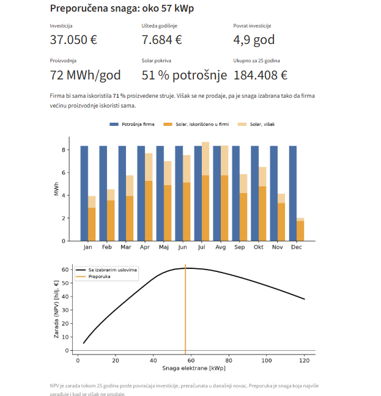

# Procena isplativosti solarnih elektrana za firme

Alat za brzu prethodnu procenu isplativosti krovnih solarnih elektrana za privredne subjekte u Srbiji. Na osnovu lokacije, potrošnje i radnog vremena objekta određuje optimalnu snagu elektrane i daje ključne finansijske pokazatelje investicije.

**👉 Aplikacija: [solar-procena-ugordic.streamlit.app](https://solar-procena-ugordic.streamlit.app/)**

*Primer: proizvodni objekat u Kragujevcu, 100 MWh godišnje, rad pon–pet 9–17 i subotom 8–13.*

## Namena
Prvi korak u odlučivanju o investiciji: da li solarna elektrana ima smisla za dati objekat, koje je okvirne snage i za koliko se investicija vraća. Rezultat služi kao osnova za detaljnu analizu i razgovor sa izvođačem.

**Ulazni podaci:** lokacija, godišnja ili mesečna potrošnja električne energije, radno vreme objekta, cena električne energije, vrednost viška predatog u mrežu, raspoloživa snaga krova.
**Rezultati:** preporučena snaga, investicija, godišnja ušteda, period povrata, proizvodnja, udeo sopstvene potrošnje i pokrivenosti potrošnje, mesečni energetski bilans i NPV u zavisnosti od snage elektrane.

## Metodologija
1. **Sunčevo zračenje i meteorološki podaci:** tipična meteorološka godina (TMY) za lokaciju iz baze [PVGIS](https://re.jrc.ec.europa.eu/pvg_tools/en/) Zajedničkog istraživačkog centra Evropske komisije.
2. **Proizvodnja:** satni model fotonaponskog sistema u biblioteci [pvlib](https://pvlib-python.readthedocs.io/) (transpozicija zračenja na ravan panela, temperatura ćelija, gubici sistema po PVWatts metodologiji, efikasnost i ograničenje snage invertora).
3. **Potrošnja:** satni profil potrošnje izveden iz mesečnih podataka i radnog vremena objekta.
4. **Energetski bilans:** za svaki od 8.760 sati u godini određuje se energija iskorišćena na objektu, višak predat u mrežu i energija preuzeta iz mreže.
5. **Ekonomska analiza:** novčani tok za 25 godina uz rast cene električne energije i degradaciju panela; neto sadašnja vrednost (NPV) i period povrata.
6. **Izbor snage:** preporučena snaga maksimizuje NPV uz pretpostavku da se višak energije ne prodaje, što daje preporuku otpornu na nesigurnost tržišne vrednosti viška (od 2026. nove firme u Srbiji nemaju pravo na neto merenje).

## Ključne pretpostavke
Paneli orijentisani ka jugu, nagib 30°, odnos snage panela i invertora 1,2; cena elektrane 650 €/kWp ključ u ruke; održavanje 1 % investicije godišnje; rast cene električne energije 2 % godišnje; degradacija panela 0,5 % godišnje; vek projekta 25 godina; diskontna stopa 7 %.

## Ograničenja
Rezultat je prethodna procena, a ne ponuda ni tehnički projekat. Ne uzimaju se u obzir lokalne senke, troškovi angažovane snage, finansiranje i porezi. Detaljna analiza obuhvata stvarne podatke sa brojila, konkretnu konfiguraciju krova, ponude za opremu, baterijsko skladištenje, scenarije cena i analizu osetljivosti, uz izveštaj sa preporukom.

**Autor:** Uroš Gordić, dipl. inž. elektrotehnike i računarstva. Analize isplativosti solarnih elektrana i baterijskih sistema. Kontakt je dostupan u aplikaciji.

---

# Rooftop solar feasibility estimate for businesses

**App: [solar-procena-ugordic.streamlit.app](https://solar-procena-ugordic.streamlit.app/)**

A pre-feasibility tool for commercial rooftop PV in Serbia. Based on site location, annual or monthly electricity consumption and operating hours, it determines the optimal system size and the key financial indicators of the investment.

**Method:** typical meteorological year from PVGIS (European Commission JRC); hourly PV simulation with pvlib (plane-of-array transposition, cell temperature, PVWatts losses, inverter efficiency and clipping); hourly load profile derived from monthly consumption and operating hours; 8,760-hour self-consumption balance; 25-year cash flow with electricity price escalation and module degradation; NPV and payback. The recommended size maximizes NPV assuming surplus energy is not sold, which makes the recommendation robust to uncertain export value.

**Limitations:** pre-feasibility estimate, not a quotation or engineering design. Local shading, demand charges, financing and taxes are not included.

**Author:** Uroš Gordić, BSc in Electrical and Computer Engineering. Feasibility analyses of solar PV and battery storage systems.

---

Lokalno pokretanje: `pip install -r requirements.txt`, zatim `streamlit run app.py`. Kontakt prikazan u aplikaciji čita se iz Streamlit Secrets (`KONTAKT_IME`, `KONTAKT_EMAIL`, `KONTAKT_TELEFON`).
